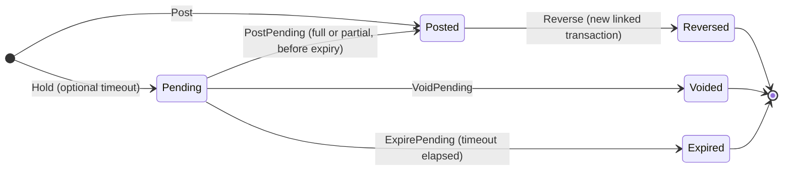

# ledger-go

[](https://github.com/victorcondackdev/ledger-go/actions/workflows/ci.yml)
[](https://pkg.go.dev/github.com/victorcondackdev/ledger-go)

A double-entry ledger core for Go: the part of a fintech or BaaS platform
that owns accounts and balances and must never be wrong. Balanced
multi-leg transactions, two-phase transfers, idempotent retries,
reversals instead of updates, and a hash-chained audit log, behind a storage
interface designed to map one-to-one onto a SQL transaction.

Standard library only. Go 1.22+.

```
money/            Amount (int64 minor units + ISO 4217), Allocate, pt-BR formatting
ledger/           accounts, transactions, two-phase transfers, queries, audit chain
ledger/memstore/  concurrency-safe in-memory Store (reference implementation)
migrations/       PostgreSQL schema reference for a SQL Store
cmd/ledger-demo/  runnable digital-bank scenario
```

## Why

Most ledger bugs are not arithmetic bugs; they are invariant bugs that only
show up under concurrency, retries or partial failure. This library makes
the invariants the API:

- **Atomic invariants.** Every write is one `Store.Update`: debits equal
  credits per currency, posting currency matches the account, frozen
  accounts receive nothing, `NoOverdraft` accounts never go below zero
  *available* (pending holds included). A rejected request leaves no trace.
- **Two-phase transfers.** `Hold` → `PostPending` (full or partial) /
  `VoidPending` / expiry — card authorization and capture, Pix funds blocked
  under MED, escrow.
- **Immutable history.** Nothing is ever updated. Refunds are `Reverse`:
  a new transaction mirroring the original and linked to it.
- **Idempotency built in.** Same key and same request returns the original
  transaction; same key and a different request is an error, even when the
  two race on different accounts.
- **Tamper evidence.** Each transaction stores SHA-256(previous hash ‖
  canonical encoding). `VerifyChain` detects any edited, inserted, deleted or
  reordered row and returns a head hash you can anchor externally.
- **Tested like a distributed system.** A seeded simulation runs random
  concurrent transfers, holds, partial captures, reversals, retries,
  conflicting retries, freezes and expiry sweeps under `-race`, with an
  auditor checking the trial balance from live snapshots, then asserts the
  global invariants. With one worker the run is reproducible down to the
  final chain hash.

## Concepts

| Concept | Meaning |
|---|---|
| `Account` | ID, chart code, currency, type (asset, liability, equity, revenue, expense), normal balance (derived from type, overridable for contra accounts), flags `NoOverdraft`, `Frozen`. |
| `Posting` | One leg: account, `Debit`/`Credit`, positive `money.Amount`. |
| `Transaction` | Sealed record: ID (UUIDv7), gap-free `Seq`, kind, idempotency key, `Ref` to a related transaction, timestamp, description, metadata, postings, request hash, previous hash, hash. |
| `Balances` | Four counters per account — debits/credits × posted/pending — plus a version. `Balance` interprets them as posted, pending and available on the normal side. |
| `Entry` | Effect of one leg on one account with the counters right after it: the source for statements and point-in-time balances. |

Transfer lifecycle:



A hold moves pending counters only. Posting it releases the whole hold and
posts the captured amount; for multi-leg holds (amount plus fee) the captured
amount is spread over the legs with `Allocate`, so the split is preserved to
the centavo.

## Quick start

```go
import (
	"github.com/victorcondackdev/ledger-go/ledger"
	"github.com/victorcondackdev/ledger-go/ledger/memstore"
	"github.com/victorcondackdev/ledger-go/money"
)

l := ledger.New(memstore.New())

l.OpenAccount(ctx, ledger.Account{ID: "asset:reserves", Currency: money.BRL, Type: ledger.Asset})
l.OpenAccount(ctx, ledger.Account{ID: "wallet:alice", Currency: money.BRL, Type: ledger.Liability, Flags: ledger.NoOverdraft})
l.OpenAccount(ctx, ledger.Account{ID: "wallet:bob", Currency: money.BRL, Type: ledger.Liability, Flags: ledger.NoOverdraft})
l.OpenAccount(ctx, ledger.Account{ID: "revenue:fees", Currency: money.BRL, Type: ledger.Revenue})

amount := money.MustParse(money.BRL, "250.00")
fee := money.MustParse(money.BRL, "0.99")
total, _ := amount.Add(fee)

postings := []ledger.Posting{
	{Account: "wallet:alice", Direction: ledger.Debit, Amount: total},
	{Account: "wallet:bob", Direction: ledger.Credit, Amount: amount},
	{Account: "revenue:fees", Direction: ledger.Credit, Amount: fee},
}
tx, err := l.Post(ctx, ledger.Request{
	IdempotencyKey: endToEndID, // the Pix EndToEndId: retries return the original
	Description:    "Pix to Bob",
	Postings:       postings,
})
switch {
case errors.Is(err, ledger.ErrInsufficientFunds): // nothing was written
case errors.Is(err, ledger.ErrIdempotencyConflict): // key reused for a different request
}

// Two-phase: authorize R$ 250,99, capture R$ 100,00 (legs scaled), release the rest.
hold, _ := l.Hold(ctx, ledger.Request{Postings: postings, Timeout: 7 * 24 * time.Hour})
capture := money.MustParse(money.BRL, "100.00")
l.PostPending(ctx, ledger.ResolveRequest{ID: hold.ID, Amount: &capture})

// Refund.
l.Reverse(ctx, ledger.ResolveRequest{ID: tx.ID, IdempotencyKey: "refund-" + endToEndID})

// Queries and audits.
st, _ := l.Statement(ctx, "wallet:alice", ledger.StatementOptions{Limit: 50}) // st.NextCursor
b, _ := l.BalanceAt(ctx, "wallet:alice", endOfDay)
tb, _ := l.TrialBalance(ctx) // tb.Check() == nil
head, err := l.VerifyChain(ctx)
```

Runnable versions of all of the above are the `Example` functions in
[`ledger/example_test.go`](ledger/example_test.go) and
[`money/example_test.go`](money/example_test.go). For an end-to-end scenario
with statements and a trial balance:

```
go run ./cmd/ledger-demo
```

## Design notes

**int64 minor units.** Amounts are integers of the currency's minor unit
(`BRL` 2, `JPY` 0, `KWD` 3, `CLF` 4), never floats. Every arithmetic
operation is overflow-checked and returns an error instead of wrapping;
balances are checked the same way. `Allocate` uses the largest-remainder
method with 128-bit intermediates (`math/bits`), so parts always sum exactly
to the input and each part is within one minor unit of its exact share.
Parsing is digit-by-digit and rejects anything it would have to round.

**Lock ordering.** A write locks exactly the accounts it touches, sorted by
`AccountID` and deduplicated. Because every writer acquires locks in the
same global order, no cycle of waiters can form: a transfer A→B and a
transfer B→A at the same instant serialize instead of deadlocking, and
transfers on disjoint accounts do not contend on account locks at all. In
the memstore the order is: account mutexes → chain-head mutex (taken late,
only to seal and append) → the map write lock (only while publishing a
commit). In SQL it is `SELECT ... ORDER BY account_id FOR UPDATE` followed by
`SELECT ... FROM chain_head FOR UPDATE`.

**The chain head is a deliberate serialization point.** A single hash chain
gives a total order (`Seq`) and tamper evidence over the whole history, at
the cost of one global critical section per commit. In the memstore it is
short — everything that can fail is validated before the head is taken. In
SQL it is not: the `chain_head` row lock is held until `COMMIT`, durable
flush included, so a single chain caps write throughput at roughly one
commit latency per transaction. That is the honest trade-off of this
design. The planned answers for high-volume deployments are one chain per
shard with periodic cross-shard checkpoints, or committing with a sequence
only and sealing the chain asynchronously in a single writer.

**Idempotency semantics.** Keys live in one namespace across all operations.
Each request is fingerprinted (SHA-256 of a canonical encoding of the
operation and its inputs) and the fingerprint is part of the sealed
transaction. Inside the update, a key that already exists returns the stored
transaction if the fingerprint matches and `ErrIdempotencyConflict`
otherwise. Two first-time requests with the same key can both see it as
free when they lock different accounts; the store's unique constraint
decides at commit (`ErrDuplicateIdempotencyKey`, a unique violation in SQL)
and the loser retries once, which turns into a replay or a conflict.
Replays do not fire commit hooks.

**Why reversals, not updates.** A posted transaction is a fact that
downstream systems (statements already sent, regulators, reconciliation,
the outbox) have observed. Editing it rewrites history for some observers
and not others. A reversal is a new fact with its own timestamp, linked by
`Ref`, subject to the same invariants (it fails with `ErrInsufficientFunds`
if the money already left a `NoOverdraft` account — exactly the MED partial
recovery problem), and the audit chain stays verifiable. Pending transfers
follow the same rule: the hold transaction is immutable, and its resolution
is a new transaction plus a small state-machine record.

**Point-in-time balances without replay.** Each entry stores the counters
after it, and timestamps are clamped to be non-decreasing along the chain,
so `BalanceAt` is one binary search (one index lookup in SQL) and statement
running balances come for free. Cursors are keyed on the per-account entry
sequence, so pages are stable while new activity arrives.

**Frozen accounts** reject posted and held effects in both directions, but
releasing a hold is allowed: voiding or expiring an authorization only
returns money to where it was.

**Hooks and outbox.** `WithOnCommit` hooks run after commit, outside all
locks, at most once and in-process. They are a wake-up signal, not a
delivery guarantee; a durable relay tails `Transactions(afterSeq, limit)`,
which is gap-free and ordered.

**SQL mapping.** `migrations/postgres.sql` is a reference schema (not
exercised by tests here): balances table updated in the same transaction
with `CHECK` constraints for non-negative counters and no-overdraft — no
triggers and no deferred constraints, because the ledger writes each
account's final counters once per transaction — unique indexes for keys,
reversals and pending resolutions, entries keyed by `(account_id,
account_seq)`, and audit views for unbalanced transactions and the trial
balance.

## Testing

```
go test -race ./...                         # unit, example, simulation tests
go test -race -short ./...                  # quicker simulation
go test ./ledger -run Simulation -v -sim.seed=7 -sim.workers=16 -sim.ops=10000
go test ./money -run '^$' -fuzz FuzzAllocate -fuzztime 30s
go test ./ledger -run '^$' -bench . -benchmem
```

The simulation (`ledger/sim_test.go`) asserts, after thousands of
concurrent operations: trial balance zero (posted and pending), no
`NoOverdraft` account negative, the sum of credit-normal balances equal to
the funded amount (internal transfers, fees, holds and reversals conserve
money), no pending amounts left once holds are resolved, every idempotency
key mapped to exactly the transaction its caller saw, a valid audit chain,
balances equal to a replay of entries, and one commit hook per transaction.
The fuzzers check that parsing is exact against `math/big`, that formatting
round-trips through parsing in every locale, and that `Allocate` preserves
the sum, the sign and the one-minor-unit bound.

Coverage (`go test -race -cover ./...`): 95.5% of statements overall —
`money` 99.6%, `ledger` 95.7%, `ledger/memstore` 95%, `cmd/ledger-demo` 81%.

## Benchmarks

Measured with `go test ./ledger -run '^$' -bench . -benchmem -count 6`
(median of 6 runs) on Go 1.24.7, linux/amd64, `Intel(R) Xeon(R) Processor @
2.10GHz`, 2 vCPUs (`GOMAXPROCS=2`), on a shared cloud VM — treat the numbers
as orders of magnitude; run-to-run spread was about ±30%. The store is the
in-memory `memstore`; every transaction is validated, fingerprinted, sealed
with SHA-256, appended to the chain and indexed.

| Benchmark | What it does | ns/op | tx/s | B/op | allocs/op |
|---|---|---:|---:|---:|---:|
| `Post` | 1 goroutine, 2-leg transfer | 8,968 | 111,954 | 4,467 | 76 |
| `PostIdempotent` | + idempotency key and metadata | 12,840 | 77,931 | 5,741 | 96 |
| `PostParallelDisjoint` | `RunParallel`, disjoint account pairs | 10,646 | 93,935 | 4,445 | 76 |
| `PostParallelHotAccount` | `RunParallel`, every transfer also credits one fee account | 13,927 | 71,821 | 5,318 | 91 |
| `HoldPost` | `Hold` + `PostPending` (2 transactions) | 33,692 | — | 13,219 | 160 |
| `TrialBalance` | snapshot over 1,000 accounts + `Check` | 1,061,929 | — | 884,736 | 22 |

Reading the numbers: with two cores and a single audit chain, parallel
writers do not beat a single writer — commits serialize on the chain head by
design, and the hot-account case adds lock hand-offs on the fee account.
What ordered locking buys is correctness under contention without deadlocks
or retries; scaling writes beyond one chain is a roadmap item (see Design
notes).

## Roadmap

- `pgstore`: PostgreSQL `Store` on `database/sql`, with the reference
  schema, serialization-failure retries and a transactional outbox table.
- CockroachDB store (same schema; `SELECT FOR UPDATE` plus retry loop).
- Multi-currency FX postings: a conversion as one transaction with legs in
  both currencies through FX position accounts, rate and source in sealed
  metadata.
- Partial reversals (MED partial recovery) with cumulative tracking.
- Sharded audit chains with periodic checkpoints for higher write
  throughput; account lifecycle events (open, freeze) in the chain.
- Snapshot and restore for the memstore.

## License

MIT — see [LICENSE](LICENSE).
